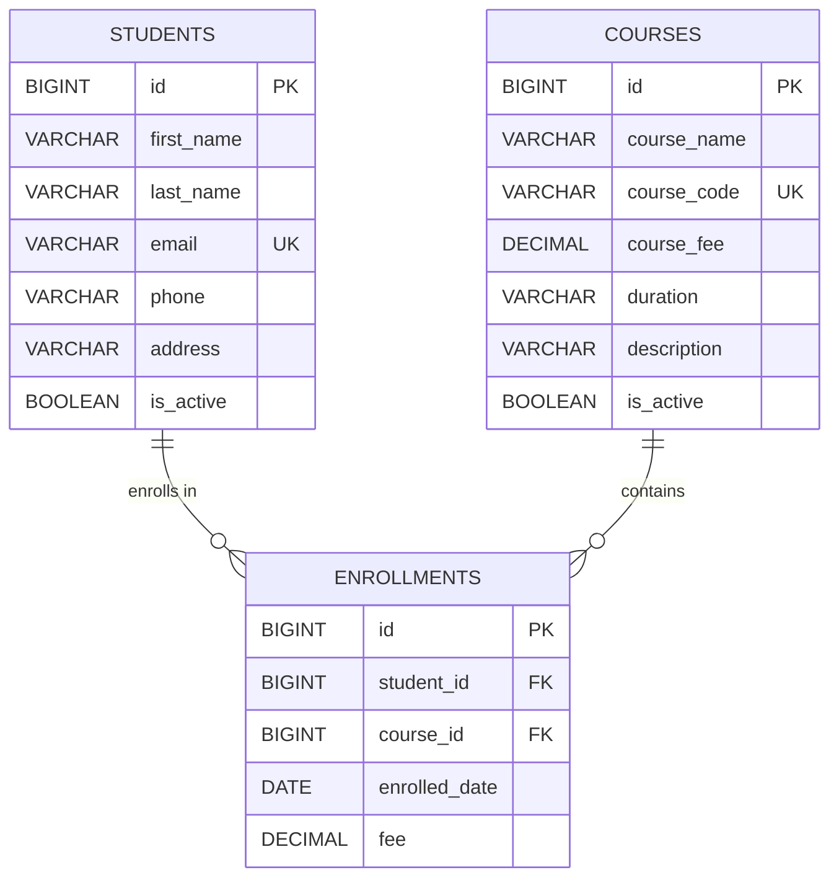

# ER Diagram - Student Management System

This document describes the database design of the project.

## Diagram (Mermaid)



> A rendered version is also available as [ER-Diagram.svg](ER-Diagram.svg).

## Entities in plain words

| Entity | Purpose |
|--------|---------|
| **students** | One row per student (name, contact, address, active flag). |
| **courses** | One row per course offered (name, code, fee, duration, description). |
| **enrollments** | Associative (join) entity. One row = "this student joined this course on this date at this fee". |

## Why a join entity instead of `student_ids` inside `courses`?

- A student can join **many** courses and a course can have **many** students -> classic *many-to-many*.
- A pure `@ManyToMany` join table can only carry the two ids. We also need
  **enrolled date** and the **fee at the time of enrollment** (a snapshot),
  so the join table becomes a full entity with its own primary key.
- The `UNIQUE (student_id, course_id)` constraint guarantees a student cannot
  enroll in the same course twice - database level protection, not only UI.

## Relationships

| Relationship | Type | Implementation |
|--------------|------|----------------|
| students -> enrollments | 1 : N | `@OneToMany(mappedBy = "student")` in `Student`, `@ManyToOne` in `Enrollment` |
| courses -> enrollments | 1 : N | `@OneToMany(mappedBy = "course")` in `Course`, `@ManyToOne` in `Enrollment` |

## DDL (generated by Hibernate, this is what MySQL gets)

```sql
CREATE TABLE students (
    id         BIGINT AUTO_INCREMENT PRIMARY KEY,
    first_name VARCHAR(50)  NOT NULL,
    last_name  VARCHAR(50)  NOT NULL,
    email      VARCHAR(100) NOT NULL UNIQUE,
    phone      VARCHAR(20),
    address    VARCHAR(255),
    is_active  BOOLEAN      NOT NULL
);

CREATE TABLE courses (
    id          BIGINT AUTO_INCREMENT PRIMARY KEY,
    course_name VARCHAR(100)   NOT NULL,
    course_code VARCHAR(20)    NOT NULL UNIQUE,
    course_fee  DECIMAL(10, 2) NOT NULL,
    duration    VARCHAR(30)    NOT NULL,
    description VARCHAR(1000),
    is_active   BOOLEAN        NOT NULL
);

CREATE TABLE enrollments (
    id            BIGINT AUTO_INCREMENT PRIMARY KEY,
    student_id    BIGINT         NOT NULL,
    course_id     BIGINT         NOT NULL,
    enrolled_date DATE           NOT NULL,
    fee           DECIMAL(10, 2) NOT NULL,
    CONSTRAINT fk_enrollments_student FOREIGN KEY (student_id) REFERENCES students (id),
    CONSTRAINT fk_enrollments_course  FOREIGN KEY (course_id)  REFERENCES courses (id),
    CONSTRAINT uq_student_course UNIQUE (student_id, course_id)
);
```

## Notes about the fee snapshot

`enrollments.fee` is copied from `courses.course_fee` **at enrollment time**
(`EnrollmentServiceImpl.enrollStudent`). If the course fee is raised later,
old enrollment totals on the "Enrolled Students" screen stay correct.
This is a small detail that interviewers really like.
